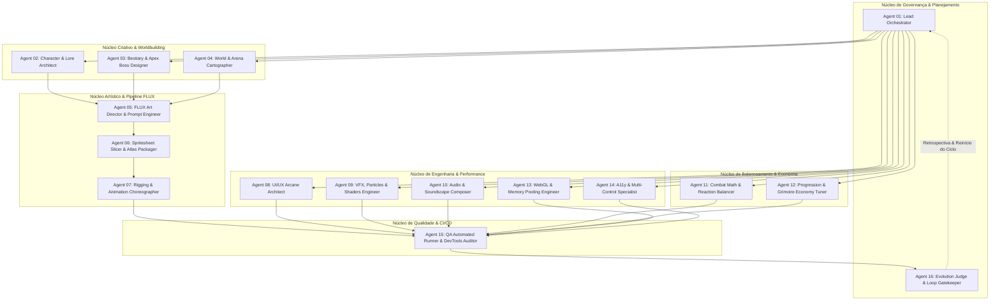

# 🧙‍♂️ Team Habey: Macetando Infinitamente — Arquitetura do Sistema Multi-Agentes (Multi-Agent Swarm)

> **Padrão Arquitetural**: ECC Multi-Agent Swarm com Comunicação por Barramento de Eventos e Portões de Aceite Determinísticos (*Merge Gates*).
> **Versão**: 1.1.0-alpha
> **Regra de Operação**: Nenhum agente pode avançar para a próxima etapa sem que a etapa anterior tenha gerado evidência verificável (testes verdes, build sem erros, atlas válidos e métricas estáveis).

---

## 🏛️ Matriz de Agentes Especializados (16 Agentes)

---

### Agente 01: Lead Orchestrator (`lead-orchestrator`)
- **Proprietário**: Antigravity Core Lead
- **Escopo**: Coordenação do avanço das 20 etapas do roadmap, gestão de dependências entre agentes, resolução de bloqueios e manutenção do estado global.
- **Entrada**: `roadmap.md`, relatórios de execução de cada agente.
- **Saída**: Despacho de tarefas, logs de sincronização e transição de etapas.
- **Portão de Aceite (Merge Gate)**: Todas as tarefas da etapa atual com evidência de aprovação registrada.

---

### Agente 02: Character & Lore Architect (`character-architect`)
- **Proprietário**: Mestre de Lore & Design de Heróis
- **Escopo**: Especificação dos 10 Magos Elementais (Petrus, Ignis, Marina, Zephyr, etc.), arquétipos de combate, atributos base, afinidades elementais, sinergias e pets guardiões.
- **Entrada**: `src/config/charactersData.js`, `src/config/enemiesData.js`.
- **Saída**: Tabelas canônicas de heróis, passivas inatas e especificações para geração de arte.
- **Portão de Aceite**: 100% dos Magos com atributos balanceados e sem sobreposição de identidade.

---

### Agente 03: Bestiary & Apex Boss Designer (`bestiary-designer`)
- **Proprietário**: Especialista em Inimigos & Encontros
- **Escopo**: Hierarquia dos monstros (swarms, atiradores, tanques), hordas cronometradas a cada 45s e os Chefes Supremos de Marco (Apex Bosses a cada 10 níveis: Nv 10 Golem Rochoso, Nv 20 Fênix Solar, Nv 30 Leviatã, etc.).
- **Entrada**: `src/config/enemiesData.js`, `src/systems/EnemySpawner.js`.
- **Saída**: Definição de padrões de ataque, telegrafia de dano (red circles/cones) e escalonamento de vida/velocidade.
- **Portão de Aceite**: Validador de balanceamento confirmando curvas de HP exponenciais sem picos injustos.

---

### Agente 04: World & Arena Cartographer (`arena-cartographer`)
- **Proprietário**: Diretor de Ambientes & Biomas
- **Escopo**: Criação do mapa infinito de fantasia sombria, biomas arcanos (Ruínas de Aethelgard, Cavernas de Cristal, Pântano Corrompido), santuários de cura, altares de sacrifício e geração procedural de tiles.
- **Entrada**: `src/scenes/GameScene.js`, texturas de terreno.
- **Saída**: Sistema de repetição contínua sem quebras de costura (seamless tilemap), obstáculos interativos e templos mágicos.
- **Portão de Aceite**: Ausência de costuras visuais na rolagem da câmera e zero colisão invisível.

---

### Agente 05: FLUX Art Director & Prompt Engineer (`flux-art-director`)
- **Proprietário**: Engenheiro de Arte Generativa
- **Escopo**: Criação e otimização de prompts estruturados para o FLUX Schnell (Forge local em `D:\AI_Art`), controle de seeds, proporções e garantia de consistência no estilo *Pixel Art Dark Fantasy 32-bit com iluminação mágica vibrante*.
- **Entrada**: Especificações de `character-architect`, `bestiary-designer` e `arena-cartographer`.
- **Saída**: Imagens brutas geradas em lote via API REST (`http://127.0.0.1:7860/sdapi/v1/txt2img`).
- **Portão de Aceite**: Imagens sem distorções anatômicas graves, contraste cromático aprovado para legibilidade em gameplay.

---

### Agente 06: Spritesheet Slicer & Atlas Packager (`spritesheet-slicer`)
- **Proprietário**: Engenheiro de Pipeline de Assets
- **Escopo**: Remoção de fundo (canal alfa puro), recorte de frames, geração de atlas de texturas compatíveis com Phaser 3 e **centralização canônica única em `public/assets/sprites`**, eliminando redundância em `assets/sprites`.
- **Entrada**: Saídas brutas de `flux-art-director`, script `tools/process_sprites.mjs`.
- **Saída**: Spritesheets padronizados (64x64, 96x96, 128x128) e metadados JSON em `public/assets/sprites`.
- **Portão de Aceite**: Execução de `npm run sprites` gravando diretamente em `public/assets/sprites` e validado por carregamento no Phaser.

---

### Agente 07: Rigging & Animation Choreographer (`character-animator`)
- **Proprietário**: Animador Técnico 2D
- **Escopo**: Configuração de animações no Phaser (`idle`, `walk`, `cast`, `hit`, `death`), interpolação de quadros, sincronização dos 4 braços articulados do Petrus e efeitos visuais acoplados aos frames de ataque.
- **Entrada**: `src/systems/AssetManager.js`, `src/entities/Player.js`, `src/entities/Enemy.js`.
- **Saída**: Definição de taxas de quadros (`frameRate: 8-12 fps`), repetições (`repeat: -1`) e eventos de final de animação.
- **Portão de Aceite**: Todas as entidades animando de forma fluida sem flickering ou salto de escala.

---

### Agente 08: UI/UX Arcane Architect (`ui-ux-designer`)
- **Proprietário**: Arquiteto de Interface de Usuário
- **Escopo**: Menus imersivos com estética *Glassmorphism Dark Fantasy*, HUD limpa, barra de XP fluida, árvore de talentos interativa, modais acessíveis (`role="dialog"`, `aria-modal="true"`) com retenção de foco e retorno de foco.
- **Entrada**: `index.html`, `css/style.css`, `src/ui/UIManager.js`.
- **Saída**: Interface responsiva e modularizada em componentes menores (Menu, HUD, Modais, Grimório).
- **Portão de Aceite**: Conformidade com critérios WCAG e zero corte de layout em telas de 320px a 4K.

---

### Agente 09: VFX, Particles & Shaders Engineer (`vfx-shader-engineer`)
- **Proprietário**: Especialista em Efeitos Visuais & WebGL
- **Escopo**: Criação de auras elementais para as 7 Reações Elementais (Sobrecarga de Fogo, Vórtice de Vento, etc.), impacto visual de crítico, rastro de projéteis e pooling de emissores de partículas para eliminar GC churn.
- **Entrada**: `src/scenes/GameScene.js`, `src/systems/CombatSystem.js`.
- **Saída**: Emissores de partículas reaproveitáveis e efeitos de pós-processamento (screenshake, flash de impacto).
- **Portão de Aceite**: 60 FPS estáveis mesmo durante hordas com mais de 300 inimigos simultâneos.

---

### Agente 10: Audio & Soundscape Composer (`audio-architect`)
- **Proprietário**: Designer Sonoro & Compositor
- **Escopo**: Geração e síntese de efeitos sonoros para magias, impactos de lâmina, passos, gemidos de monstros, alerta de Boss e trilha sonora dinâmica com variação de intensidade baseada na quantidade de monstros na tela.
- **Entrada**: `src/systems/SoundManager.js`.
- **Saída**: Efeitos de áudio sintéticos (Web Audio API) de baixa latência e controle mestre de volume e mudo.
- **Portão de Aceite**: Sons sem estalo/clipping e sem bloqueio no primeiro toque do jogador.

---

### Agente 11: Combat Math & Reaction Balancer (`combat-balancer`)
- **Proprietário**: Matemático de Sistemas de Combate
- **Escopo**: Modelagem e balanceamento das 12 Armas Ativas, 12 Passivas, 12 Evoluções (★), 6 Fusões Duplas (★★) e Reações Elementais. Desacoplamento da lógica de reações e dano de `CombatSystem.js` para submódulos testáveis.
- **Entrada**: `src/systems/CombatSystem.js`, `src/config/weaponsData.js`, `tools/validate_balance.mjs`.
- **Saída**: Submódulos desacoplados (`ElementalReactionMatrix.js`, `DamageCalculator.js`) e simulações com zero loop infinito.
- **Portão de Aceite**: `npm run balance` executando com 100% de sucesso e tempo de sobrevivência médio balanceado em 15-20 minutos.

---

### Agente 12: Progression & Grimoire Economy Tuner (`progression-tuner`)
- **Proprietário**: Economista de Jogos & Retenção
- **Escopo**: Curva de acúmulo de ouro, desbloqueio de novos Magos e armas no Grimório de Almas, árvore de talentos permanentes e proteção de dados em `SaveManager.js` com validação de schema, migração de versões e fallback de cota.
- **Entrada**: `src/systems/SaveManager.js`.
- **Saída**: Sistema de salvamento resiliente a corrupção (backup antes de resetar), tratamento de `QuotaExceededError` e feedback visual ao salvar.
- **Portão de Aceite**: Teste de estresse com save corrompido restaurando backup sem travar o jogo.

---

### Agente 13: WebGL & Memory Pooling Engineer (`performance-optimizer`)
- **Proprietário**: Engenheiro de Performance de Baixo Nível
- **Escopo**: Implementação de pools de objetos para projéteis, orbes de XP, textos de dano flutuante e partículas ambientais em `GameScene.js`, eliminando chamadas repetidas a `this.add.image` e `this.tweens.add` no loop principal.
- **Entrada**: `src/scenes/GameScene.js`, `src/systems/CombatSystem.js`.
- **Saída**: Módulos de Object Pooling para partículas e partículas ambientais sem alocação dinâmica contínua.
- **Portão de Aceite**: Heap de memória estável (< 80 MB) durante 10 minutos contínuos de partida.

---

### Agente 14: A11y & Multi-Control Specialist (`controls-a11y-lead`)
- **Proprietário**: Especialista em Acessibilidade & Controles
- **Escopo**: Suporte híbrido simultâneo a Teclado (WASD/Setas), Mouse, Gamepad (Xbox/PlayStation via Gamepad API) e Virtual Joystick para celular, além de permitir zoom do navegador no `index.html` e gerenciamento de foco nos diálogos.
- **Entrada**: `index.html`, `src/ui/UIManager.js`, `src/entities/Player.js`.
- **Saída**: Controles suaves sem conflito de evento com o DOM e conformidade com diretrizes de acessibilidade.
- **Portão de Aceite**: Jogo jogável 100% apenas pelo teclado (inclusive navegação em menus) e sem travas de zoom no viewport.

---

### Agente 15: QA Automated Runner & DevTools Auditor (`qa-e2e-tester`)
- **Proprietário**: Engenheiro de Automação de Testes
- **Escopo**: Execução de suites automatizadas de teste com Playwright (`tools/qa_runner.mjs`), inspeção de console por erros/warnings, simulação de partidas com input virtual e validação de tela cheia/responsividade.
- **Entrada**: `tools/qa_runner.mjs`, servidor de teste local (`http://localhost:5173`).
- **Saída**: Relatório detalhado de QA com capturas de tela e métricas de FPS médio e logs limpos.
- **Portão de Aceite**: Zero erros ou avisos graves capturados no console do navegador durante o teste automatizado.

---

### Agente 16: Evolution Judge & Loop Gatekeeper (`evolution-judge`)
- **Proprietário**: Guardião da Qualidade & Ciclo de Vida
- **Escopo**: Auditoria final de cada ciclo de 20 etapas. Valida se todos os portões de aceite foram cumpridos, dispara o pipeline de CI/CD para GitHub Pages e reabre o ciclo de produção na Etapa 01 para novas iterações de polimento e maturidade.
- **Entrada**: Relatórios de todos os 15 agentes, status do build do Vite.
- **Saída**: Atualização da versão semântica de maturidade, commit no repositório e relatório de ciclo concluído.
- **Portão de Aceite**: Build de produção verde (`npm run build`), testes de CI verdes e deploy ativo no GitHub Pages.

---

## 🔄 Protocolo de Comunicação e Ciclo de Vida

1. **Barramento de Eventos de Projeto**:
   - Cada agente emite mensagens de conclusão: `EVENT: [AGENTE] -> [ETAPA] -> CONCLUÍDO { evidência: ... }`.
2. **Critério de Falha e Recuperação**:
   - Se um agente encontrar um erro (ex: falha de compilação ou teste quebrado), a etapa é pausada, o agente corretor correspondente é despachado, e a etapa só avança após o teste ficar verde.
3. **Loop Contínuo de Maturidade**:
   - Ao atingir a Etapa 20 com aprovação de `evolution-judge`, o sistema gera o changelog do ciclo, faz o bump da versão e reinicia na Etapa 01 para elevar a complexidade e polimento do jogo.
